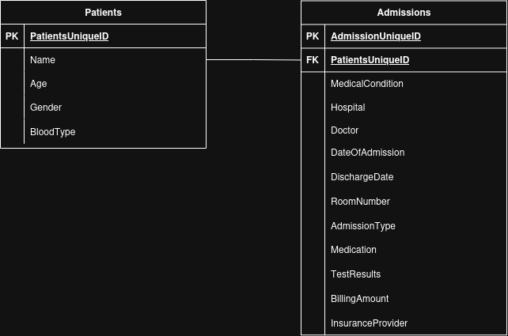

# CSV To Mongo - Medical Data Migration

## TABLE OF CONTENTS

- [Overview](#overview)
- [Features](#features)
- [Prerequisites](#prerequisites)
- [Configuration](#configuration)
- [Architecture](#architecture)
  - [Data Pipeline](#data-pipeline)
  - [Database Architecture](#database-architecture)
  - [Docker Architecture](#docker-architecture)
  - [Database Access Control and Authentication](#database-access-control-and-authentication)
- [Installation and Execution](#installation-and-execution)
- [Testing](#testing)

## OVERVIEW

This project implements a **Python pipeline** to load, clean, transform and migrate healthcare admission data from a CSV file to a MongoDB database.

The main objective is to structure patient and admission data into two separate collections, while preserving their relationships.

## FEATURES

- CSV loading with pandas.
- Data cleaning and duplicate removal.
- Data validation.
- Patient identification and data transformation.
- Migration to MongoDB using PyMongo.
- MongoDB index creation.
- Unit testing with pytest.
- Containerized execution with Docker Compose.

## PREREQUISITES

- Git
- Docker Engine
- Docker Compose

Python and MongoDB do not need to be installed locally beforehand. Docker Compose will take care of it when running the pipeline.

## CONFIGURATION

Before running the application, create your local environment configuration file:

```console
cp .env.example .env
```

Edit the `.env` file to match your local configuration.

The file contains the environment variables required by Docker Compose, including:

- MongoDB database names (e.g. `MONGODB_MIGRATION_DB_NAME` and `MONGODB_TEST_DB_NAME`).
- Database usernames and passwords (e.g. `MONGO_MIGRATION_USERNAME` and `MONGO_MIGRATION_PASSWORD`).
- Migration and testing configuration (e.g. `MONGODB_URI`).
- Other application-specific settings.

Make sure to use your own credentials and keep the `.env` file out of version control.

**Note:** The `.env.example` file provides default configuration values for reference. Review and update them before running the application.

## ARCHITECTURE

### Data Pipeline

The proposed pipeline works by following these steps:

- **Loading:** Read the CSV file.
- **Cleaning:** Standardize the column names, handle missing values and remove duplicates.
- **Validation:** Check the structure and validity of the data.
- **Transformation:** Separate patient information from admission records and associate patient identifiers.
- **Migration:** Insert the transformed data into MongoDB and create the necessary indexes.

### Database Architecture

The target MongoDB database is organized into two collections:

- **Patients:** Stores patient information and uses a unique business key to identify existing patients.
- **Admissions:** Stores hospital admission records and references patients through their MongoDB ObjectId.

This separation avoids duplicating patient information across multiple admissions.

Unique indexes enforce data integrity and support idempotent migration operations, allowing the pipeline to be executed repeatedly without creating duplicate records.

The following compound unique indexes are created to enforce the uniqueness of the business keys:

- **Patients:** `Name`, `Age`, `Gender`, `BloodType`.
- **Admissions:** `PatientId`, `MedicalCondition`, `DateOfAdmission`.

Below you will find the MongoDB database architecture, with the collections and their relationships represented.



### Docker Architecture

Docker Compose orchestrates the application through two main services:

- **MongoDB:** Hosts the database, manages persistent storage and initializes database users.
- **Migration:** Runs the Python pipeline and communicates with MongoDB through a dedicated Docker network.

The source CSV directory is mounted into the migration container as read-only, while a named Docker volume ensures MongoDB data persists across container restarts.

Database credentials and configuration parameters are supplied through environment variables.

### Database Access Control and Authentication

MongoDB authentication is enabled to restrict database access to authorized users.

Database users are created during the initial MongoDB container setup through an initialization script located in `mongo_init/`.

Each user is assigned specific roles according to its purpose, following the principle of least privilege.

#### User Roles

The project uses three dedicated database users:

| User             | Purpose                      | Permissions                                                                        |
| ---------------- | ---------------------------- | ---------------------------------------------------------------------------------- |
|`migration_user`  | Data migration               | Read and write access to the `medical` database                                    |
| `analyst_user`   | Data inspection and analysis | Read-only access to the `medical` database                                         |
| `tester_user`    | Automated integration tests  | Access to the dedicated test database (`medical_test`), including database cleanup |

The separation of users prevents unnecessary access to production data and limits the impact of potential errors.

#### Authentication Process and Mechanism

The authentication process follows these steps:

1. MongoDB starts with authentication enabled.
2. During the initial database initialization, the initialization script creates the required database users and assigns their respective roles.
3. When connecting to MongoDB, clients must provide valid credentials.
4. MongoDB authenticates the user against the configured authentication database.
5. Once authenticated, the user can only perform operations permitted by their assigned roles.

Concerning the mechanism at step 4, MongoDB uses SCRAM-SHA-256 (Salted Challenge Response Authentication Mechanism) to authenticate users. This challenge-response protocol verifies user credentials without transmitting the password directly in clear text during the authentication exchange.

#### Usage

The migration service authenticates using `migration_user` through environment variables.

Integration tests use `tester_user` and operate on the dedicated `medical_test` database.

For manual database inspection, users can authenticate through the MongoDB shell:

```console
docker compose exec mongodb mongosh \
  --username analyst_user \
  --password \
  --authenticationDatabase medical \
  medical
```
**Note:** The --authenticationDatabase instruction specify the database on which the user was added. It acts as a namespace, and allow to differenciate two users having the same username on different database. In our case, it can be ignored.

The analyst account provides read-only access to the migrated data.

**Security considerations:**

- Credentials are stored in the local `.env` file and excluded from version control.
- Each database user has only the permissions required for its intended purpose.
- The MongoDB root user is reserved for administrative operations. It has elevated privileges across databases and should not be used for routine data inspection or migration operations.
- The initialization script runs when MongoDB initializes a new data directory. Existing database users are not automatically recreated or updated when restarting a container with an existing persistent volume.

## INSTALLATION AND EXECUTION

### Clone the repository

```console
git clone https://github.com/arnaud-degreze/medical-data-migration.git
cd medical-data-migration
```

### Run the migration

Start MongoDB:

```console
docker compose up -d mongodb
```

Build the Python image and launch the migration:

```console
docker compose run --build --rm migration
```

The default configuration will use the sample CSV file included in the `/data` folder.

### Verify the results

Connect to MongoDB as an authorized user:

```console
docker compose exec mongodb mongosh \
  --username "user_name_you_defined" \
  --password \
  --authenticationDatabase "database_authorized_for_the_user" \
  medical
```

You will then be asked to type your password. Do not include quotation marks.

Once connected, you can inspect the collections:

```javascript
show collections

db.patients.countDocuments({})
db.admissions.countDocuments({})
```

These commands will show how many patients and admissions are stored in their respective collections.

In case you want to take a look at a document:

```javascript
db.patients.find({}).limit(1)
db.admissions.find({}).limit(1)
```

**Note:** Depending on the user you selected, certain actions will be refused. For example, the analyst user won't be able to insert any document.

To perform administrative operations, use the root user's authentication information, defined in `.env` through `MONGO_ROOT_USERNAME` and `MONGO_ROOT_PASSWORD`. However, this is not recommended for routine operations.

For more information, see [Database Access Control and Authentication](#database-access-control-and-authentication).

## TESTING

The project uses pytest to run automated unit and integration tests.

Unit tests validate individual components of the migration pipeline, while integration tests verify database operations and migration behavior against MongoDB.

Integration tests use a dedicated test database (`medical_test`) and a separate database user to avoid interfering with the main migration database.

To execute the test suite:

```console
docker compose run --build --rm migration pytest
```

